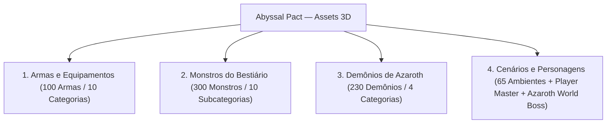

# CATÁLOGO GERAL DE ASSETS 3D — ABYSSAL PACT

> **Documento Mestre de Registro de Ativos Tridimensionais e Produção**  
> **Data:** 21 de Novembro de 2026  
> **Software de Modelagem:** Blender 5.3.0 Local (API `bpy`)  
> **Engine de Destino:** Godot Engine 4.7.2 Forward+  

---

## 1. VISÃO GERAL DO ECOSSISTEMA DE ASSETS

O projeto *Abyssal Pact* organiza seus recursos 3D em quatro pilares estritamente desacoplados:



---

## 2. ESTRUTURA DE DIRETÓRIOS CONSOLIDADA

```
Abyssal_Pact/
├── assets/
│   ├── 3d/
│   │   ├── weapons/                      # 10 Categorias de Armas
│   │   │   ├── swords/
│   │   │   ├── axes/
│   │   │   ├── hammers_maces/
│   │   │   ├── polearms/
│   │   │   ├── daggers/
│   │   │   ├── bows_crossbows/
│   │   │   ├── firearms_fantasy/
│   │   │   ├── staves_catalysts/
│   │   │   ├── special_weapons/
│   │   │   ├── shields/
│   │   │   └── previews/
│   │   │
│   │   ├── monsters/                     # 10 Subcategorias de Monstros
│   │   │   ├── humanoids/
│   │   │   ├── beasts/
│   │   │   ├── reptiles_dragons/
│   │   │   ├── undead/
│   │   │   ├── demons_abyssals/
│   │   │   ├── giants_colossi/
│   │   │   ├── magical_elementals/
│   │   │   ├── insects_arachnids/
│   │   │   ├── aquatic/
│   │   │   ├── rare_anomalies/
│   │   │   └── previews/
│   │   │
│   │   └── demons/                       # 4 Categorias de Demônios
│   │       ├── inferior/
│   │       ├── superior/
│   │       ├── supreme/
│   │       └── primordial/
│   │
│   ├── models/                           # Modelos exportados para Godot
│   ├── blender/                          # Projetos mestres .blend
│   └── previews/                         # Imagens PNG de inspeção
│
├── Weapons/                              # Fichas técnicas (100 armas)
├── Demons/                               # Fichas técnicas (230 demônios)
└── Monsters/                             # Bestiário e fichas técnicas
```

---

## 3. INVENTÁRIO CONSOLIDADO DE ATIVOS

| Pilar de Conteúdo | Quantidade Total | Modelos com Produção 3D Ativa | Arquivos de Especificação | Relatório Oficial |
|---|---:|---:|---:|---|
| **Armas e Equipamentos** | 100 armas | 5 Pilotos (.blend, .glb, .png) | 100 Fichas em `Weapons/` | [`WEAPON_PRODUCTION_REPORT.md`](file:///c:/Users/fred_/Downloads/Abyssal%20Pact/WEAPON_PRODUCTION_REPORT.md) |
| **Monstros (Bestiário)** | 300 monstros | 5 Pilotos (.blend, .glb, .png) | Catálogo JSON + Relatório | [`MONSTER_3D_PRODUCTION_REPORT.md`](file:///c:/Users/fred_/Downloads/Abyssal%20Pact/MONSTER_3D_PRODUCTION_REPORT.md) |
| **Demônios de Azaroth** | 230 demônios | 4 Unidades de Exército + Azaroth | 230 Fichas em `Demons/` | [`Demons/Audit/AUDIT_REPORT_230_DEMONS.md`](file:///c:/Users/fred_/Downloads/Abyssal%20Pact/Demons/Audit/AUDIT_REPORT_230_DEMONS.md) |
| **Ambiente e World Boss** | 67 ativos | 65 Cenários + Player + Azaroth | Relatórios de Regiões 3D | [`WORLD_BOSS_AZAROTH_REPORT.md`](file:///c:/Users/fred_/Downloads/Abyssal%20Pact/WORLD_BOSS_AZAROTH_REPORT.md) |
| **TOTAL** | **697 ativos** | **80 modelos 3D compilados** | **560+ documentos técnicos** | — |

---

## 4. ESPECIFICAÇÃO DOS MODELOS-PILOTO DESTA ETAPA

### Lote Piloto de Armas:
1. `WEAPON_001_Espada_das_Cinzas` (`assets/3d/weapons/swords/`): 95 vértices, 5 materiais PBR, Sockets `socket_hand_r`, `socket_back`, `socket_hip_l`.
2. `WEAPON_011_Machado_Runico_de_Basalto` (`assets/3d/weapons/axes/`): 147 vértices, 4 materiais PBR, Sockets `socket_hand_r`, `socket_back`.
3. `WEAPON_021_Martelo_Colossal_da_Forja` (`assets/3d/weapons/hammers_maces/`): 77 vértices, 4 materiais PBR, Sockets `socket_hand_r`, `socket_back`.
4. `WEAPON_031_Lanca_das_Cinzas_Abissais` (`assets/3d/weapons/polearms/`): 90 vértices, 4 materiais PBR, Sockets `socket_hand_r`, `socket_back`.
5. `WEAPON_091_Escudo_Torre_de_Ferro_Negro` (`assets/3d/weapons/shields/`): 107 vértices, 4 materiais PBR, Sockets `socket_hand_l`, `socket_back`.

### Lote Piloto de Monstros:
1. `MONSTER_001_Ogro_das_Cinzas` (`assets/3d/monsters/humanoids/`): 464 vértices, 5 materiais PBR, Armature 10 ossos, 2 animações.
2. `MONSTER_041_Lobo_do_Gelo_Eterno` (`assets/3d/monsters/beasts/`): 654 vértices, 9 materiais PBR, Armature 10 ossos, 2 animações.
3. `MONSTER_081_Draconiano_Vulcanico` (`assets/3d/monsters/reptiles_dragons/`): 378 vértices, 13 materiais PBR, Armature 10 ossos, 2 animações.
4. `MONSTER_111_Cavaleiro_Espectral_da_Cripta` (`assets/3d/monsters/undead/`): 492 vértices, 17 materiais PBR, Armature 8 ossos, 2 animações.
5. `MONSTER_211_Golem_de_Cristal_Arcano` (`assets/3d/monsters/magical_elementals/`): 322 vértices, 20 materiais PBR, Armature 6 ossos, 2 animações.
