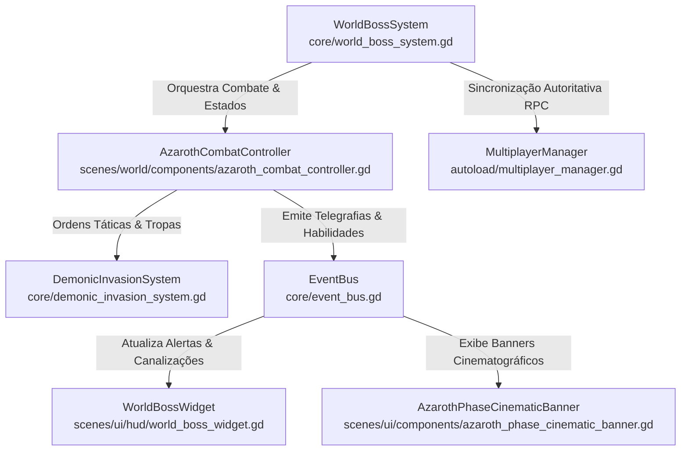

# ABYSSAL PACT — RELATÓRIO DO SISTEMA DE BATALHA DE AZAROTH
## PROMPT 05 — BATALHA CONTRA AZAROTH (WORLD BOSS SUPREMO)

---

### 1. VISÃO GERAL DA IMPLEMENTAÇÃO

Azaroth é o único World Boss do universo de **Abyssal Pact**. Ele não se comporta como um demônio comum ou superior de masmorra, mas sim como o supremo comandante da invasão demoníaca e uma colossal ameaça que molda o próprio destino do mundo privado dos jogadores.

A batalha contra Azaroth foi desenhada com 4 fases canônicas progressivas, dotadas de transições cinematográficas invulneráveis, telegrafias visuais de perigo no solo, escalonamento rigoroso de dificuldade, orquestração tática contínua do Exército Demoníaco e uma conclusão triunfal que expurga o território invadido e recompensa todos os participantes.

---

### 2. ARQUITETURA E COMPONENTES TÉCNICOS

1. **`AzarothCombatController` ([azaroth_combat_controller.gd](file:///c:/Users/fred_/Downloads/Abyssal%20Pact/scenes/world/components/azaroth_combat_controller.gd))**:
   - Máquina de estados: `IDLE`, `APPROACHING`, `TELEGRAPHING`, `CASTING`, `PHASE_TRANSITION`, `COLLAPSING`, `DEFEATED`.
   - Gerencia cooldowns, durações de telegrafia, raios de impacto e aplicação de dano em área.
   - Aplica ordens militares ao exército conforme a fase em andamento.
   - Mantém Azaroth invulnerável durante canalizações de transição cinematográfica ($4.5$s).
   - Executa a sequência cinematográfica de vitória e colapso ($6.0$s).

2. **`WorldBossSystem` ([world_boss_system.gd](file:///c:/Users/fred_/Downloads/Abyssal%20Pact/core/world_boss_system.gd))**:
   - Integração direta entre o ciclo global de 5 horas e a IA do combat controller.
   - Detecção de thresholds de HP ($75\%$, $50\%$, $25\%$, $0\%$).
   - Proteção de dano durante transições cinematográficas para ataques normais de jogadores ($< 50.000$).
   - Reset coordenado e restauração precisa de estado via `collect_save_data()` e `apply_save_data()`.

3. **`AzarothPhaseCinematicBanner` ([azaroth_phase_cinematic_banner.gd](file:///c:/Users/fred_/Downloads/Abyssal%20Pact/scenes/ui/components/azaroth_phase_cinematic_banner.gd))**:
   - Banner cinematográfico animado na interface que anuncia as transições de fase e a queda de Azaroth.
   - Apresenta títulos rúnicos abissais, subtítulos de impacto e barras de canalização com fade-in/fade-out e pulsar demoníaco.

4. **Multiplayer Autoritativo ([multiplayer_manager.gd](file:///c:/Users/fred_/Downloads/Abyssal%20Pact/autoload/multiplayer_manager.gd))**:
   - `rpc_azaroth_ability_telegraphed`: Sincroniza em todos os clientes a posição, raio e duração da área de perigo.
   - `rpc_azaroth_ability_cast`: Notifica o impacto e efeito visual do golpe.
   - `rpc_azaroth_phase_cinematic`: Dispara a cinemática de transição em sincronia para todo o grupo.
   - `rpc_azaroth_victory_sequence`: Notifica a queda de Azaroth e a entrega de recompensas mundiais.

---

### 3. AS QUATRO FASES CANÔNICAS DA BATALHA

| Fase | Nome Canônico | Limiar de HP | Multiplicador Dano | Multiplicador Velocidade | Cooldown Ataque | Duração Telegrafia | Habilidades Assinatura | Participação do Exército |
| :---: | :---: | :---: | :---: | :---: | :---: | :---: | :---: | :---: |
| **1** | **Ascensão da Fenda** | $100\% - 75\%$ | $1.0\times$ | $1.0\times$ | $4.0$s | $2.0$s - $2.2$s | *Impacto Tectônico*, *Fenda Abissal* | Patrulhas e emboscadas de Demônios Inferiores pelos flancos |
| **2** | **Fúria Vulcânica** | $75\% - 50\%$ | $1.2\times$ | $1.1\times$ | $3.2$s | $1.6$s - $1.8$s | *Chuva de Magma*, *Feixe do Abismo*, *Impacto Tectônico* | Convocação de Demônios Superiores como guarda de honra |
| **3** | **Tempestade do Caos** | $50\% - 25\%$ | $1.35\times$ | $1.2\times$ | $2.5$s | $1.4$s - $1.5$s | *Vórtice do Caos*, *Nova do Vazio* | Aceleração da emersão de Criaturas Primordiais pelas fendas |
| **4** | **O Devorador Despertado (Enrage)** | $25\% - 0\%$ | $1.6\times$ | $1.35\times$ | $1.8$s | $1.3$s | *Devoração Cataclísmica*, *Bombardeio Apocalíptico*, *Nova do Vazio* | Frenesi Abissal total: ataques em pinça simultâneos por múltiplas direções |

---

### 4. DIFICULDADE PROGRESSIVA ESTRITA

A batalha foi parametrizada para forçar uma progressão tática contínua dos jogadores:
1. **Dano Escalonado**: O dano das habilidades cresce de $+20\%$ na Fase 2 para $+60\%$ na Fase 4.
2. **Tempo de Reação Reduzido**: A telegrafia no solo diminui de $2.2$s para apenas $1.3$s no Enrage, exigindo posicionamento impecável e esquivas precisas.
3. **Cadência de Ataque**: O intervalo entre habilidades cai de $4.0$s para $1.8$s, transformando o final da batalha em uma tempestade contínua de fogo e abismo.
4. **Pressão Combinada**: O exército não para durante o combate; as tropas inferiores mantêm os jogadores em movimento, os demônios superiores pressionam a linha de frente e os primordiais absorvem dano enquanto Azaroth canaliza suas devorações.

---

### 5. TRANSIÇÕES CINEMATOGRÁFICAS E INVULNERABILIDADE

- Ao atingir cada limiar de vida ($75\%$, $50\%$, $25\%$), Azaroth interrompe seus ataques normais e entra no estado `PHASE_TRANSITION` por $4.5$ segundos.
- Durante esse período, Azaroth canaliza o Abismo, tornando-se invulnerável a dano de combate de jogadores.
- Na interface de todos os participantes conectados ao mundo privado, surge o `AzarothPhaseCinematicBanner` exibindo o nome e o perigo da nova fase, acompanhado por tremores de tela e efeitos rúnicos.
- O Exército Demoníaco recebe novas diretrizes imediatas (ex: surgimento de guardas de honra superiores ou investidas em pinça).

---

### 6. CONCLUSÃO DE VITÓRIA, EXPURGAMENTO E RECOMPENSAS

Quando os pontos de vida de Azaroth chegam a zero:
1. **Sequência de Vitória (6.0 segundos)**: Azaroth entra no estado `COLLAPSING` com a animação cinematográfica `collapse_death`, caindo de joelhos perante os heróis.
2. **Expurgamento Territorial Imediato**:
   - O `DemonicInvasionSystem` transiciona imediatamente para a fase `CLEANSED`.
   - Todas as fendas demoníacas abertas na região são seladas.
   - O nível de corrupção do território é zerado ($0.0$).
3. **Recompensas Lendárias do World Boss**:
   - Todos os guerreiros participantes recebem `50.000 XP`, `20.000 Gold`, `500 Fragmentos Abissais`, `1x Coração de Azaroth` (material lendário de forja) e `1x Título de Prestígio: O Expurgador do Devorador`.
4. **Atualização do Mundo Privado**:
   - O estado do ciclo transiciona para `DEFEATED`.
   - As estatísticas de vitórias mundiais são incrementadas e persistidas no arquivo de salvamento do mundo privado.

---

### 7. RESULTADOS DOS TESTES DE VERIFICAÇÃO

A suíte completa de testes automatizados do Abyssal Pact foi executada via Godot 4.7.2 Headless Console:
- **Total de Suítes Executadas**: 27 suítes
- **Total de Verificações Realizadas**: 4.609 verificações
- **Falhas Encontradas**: 0 falhas
- **Status Final**: **TODOS OS TESTES PASSARAM COM SUCESSO (100% GREEN)**
