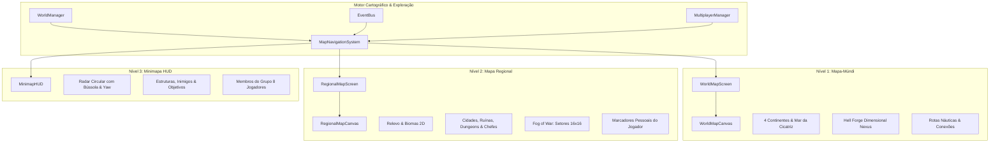

# SISTEMA COMPLETO DE MAPAS E NAVEGAÇÃO DE ABYSSAL PACT

## 1. Visão Geral da Arquitetura Cartográfica e de Navegação

O **Sistema Completo de Mapas e Navegação** de *ABYSSAL PACT* integra a cartografia matemática bidimensional (definida em `WORLD_MAP_DATA.json`, `WORLD_GEOGRAPHY.md` e `REGION_CONNECTIONS.md`) com o espaço tridimensional das 40 regiões do mundo e a dimensão independente Hell Forge.

O sistema estrutura-se em 3 níveis visuais de abstração, complementados por um subsistema de exploração com Fog of War (névoa de exploração setorial 16x16), gerenciamento de marcadores táticos, suporte completo a grupos cooperativos (até 8 jogadores) e renderização no estilo **Dark Fantasy Medieval Cartography**.

---

## 2. Nível 1 — Mapa-Múndi (World Map)

O Mapa-Múndi oferece uma visão estratégica do planeta inteiro e seus planos dimensionais:

- **Quatro Continentes Físicos:**
  - **Veyrath (CONT-01 / Noroeste):** Relevo imperial em tons sépia e carmesim oxidado (`#8c765c`).
  - **Sylvaran (CONT-02 / Nordeste):** Florestas ancestrais e pântanos em tons musgo e esmeralda profunda (`#466952`).
  - **Khar-Duum (CONT-03 / Sudoeste):** Territórios vulcânicos e desfiladeiros em obsidiana e magma frio (`#7a523d`).
  - **Nhal'Kora (CONT-04 / Sudeste):** Geleiras monumentais e tundras em tons gelo e ciano ártico (`#52718c`).
- **Mar da Cicatriz (OCEAN-01):** Abismo aquático central (`[0.5, 0.5]`) com polígono de 8 vértices, batimetria de 8.500m e vórtice marítimo intercontinental.
- **Hell Forge (DIM-HELL-FORGE):** Representada no canto superior direito como **Dimensão Independente / Nexus Extracartográfico**. Exibe anéis rúnicos concêntricos, status de Hub de Ressurgimento Obrigatório e canais permanentes/fendas ativas vinculados às 40 regiões.
- **Quarenta Regiões e Fronteiras:**
  - Todas as 40 regiões mapeadas com coordenadas normalizadas `[0.0, 1.0]`.
  - Polígonos de fronteira cartográfica renderizados com traçado medieval de pergaminho.
  - Distinção visual entre **Regiões Descobertas** (preenchimento iluminado e rótulo canônico visível) e **Regiões Ocultas** (névoa cinzenta envelhecida e interrogação cartográfica).
- **Rede de Conexões e Rotas:**
  - 5 Rotas Náuticas através do Mar da Cicatriz (com indicação de perigo cáustico, espectral e abissal).
  - Rotas terrestres inter-regionais e portais dimensionais.
- **Interatividade & Controles:**
  - Zoom dinâmico (`0.6x` a `3.0x`), Pan por clique e arraste, atalhos de foco rápido em cada continente (`Veyrath`, `Sylvaran`, `Khar-Duum`, `Nhal'Kora`, `Hell Forge`).
  - Filtros visuais: *Fronteiras*, *Rotas*, *Portais*, *POIs*.

---

## 3. Nível 2 — Mapa Regional (Regional Map)

O Mapa Regional projeta detalhadamente o território de cada uma das 40 regiões individuais:

- **Relevo e Terreno Fiel ao Bioma:**
  - Relevo com curvas de nível e hachuras em estilo pergaminho iluminado.
  - Variação cromática conforme bioma (campos de cinza, pântanos bioluminescentes, desertos de obsidiana vitrificada, tundras glaciais).
  - Limites naturais e barreiras cardeais (Norte, Sul, Leste, Oeste).
- **Estruturas, Pontos de Interesse & Chefes:**
  - **Cidades e Assentamentos:** Marcados com ícones de fortificação e raio de Safe Zone (`area_radius`).
  - **Ruínas e Estruturas Ancestrais:** Marcadores de arcos decadentes com identificação histórica.
  - **Masmorras (Dungeons):** Entradas identificadas com arcos pontiagudos e aviso de perigo.
  - **Áreas de Chefes:** Glifo de caveira e cornos de batalha indicando arena de chefes regionais descobertos.
  - **Portais Ativados e Entradas/Saídas:** Portões cardeais (`gate_north`, `gate_south`, etc.) e portais dimensionais.
- **Névoa de Guerra Gradual (Fog of War):**
  - Cada região é particionada em uma grade de **16x16 setores** (256 células de exploração).
  - Setores não explorados são cobertos por névoa densa com textura de pergaminho manchado.
  - Conforme o jogador se desloca, células dentro do raio de visão (`exploration_radius`) são desveladas permanentemente.
  - Exibição de barra de progresso da exploração regional (`0%` a `100%`).
- **Marcadores Pessoais do Jogador:**
  - O jogador pode criar marcadores personalizados com botão direito ou tecla de atalho.
  - 5 categorias visuais: *Alvo / Waypoint*, *Inimigo / Perigo*, *Recurso / Minério*, *Ponto de Interesse*, *Acampamento*.
  - Remoção intuitiva e persistência garantida nos arquivos de save do jogador.

---

## 4. Nível 3 — Minimapa HUD (Radar Widget)

O Minimapa HUD é uma bússola/radar em tempo real afixada à interface de exploração ativa:

- **Projeção e Orientação:**
  - Jogador centrado com agulha direcional indicando o ângulo de visão (*yaw*).
  - Cone de visão translúcido iluminando o campo de visão à frente (`45°`).
  - Anel de bússola cardeal clássico com inscrições medievais estilizadas (`N`, `L`, `S`, `O`).
- **Detecção Tática de Entidades:**
  - **Estruturas Próximas:** Ícones simplificados de cidades, portais e masmorras no raio de detecção.
  - **Aliados do Grupo:** Pontos coloridos e distintos para cada membro do grupo (suporta até 8 participantes cooperativos).
  - **Inimigos Detectados:** Pontos vermelhos pulsantes no radar para ameaças hostis dentro do alcance.
  - **Objetivos de Missão:** Indicadores dourados com pulsação indicando a direção e distância das quests ativas.
  - **Waypoints Pessoais:** Marcadores do jogador visíveis na borda do radar quando fora do campo visível imediato.
- **Controles HUD:**
  - Ajuste rápido de zoom (`0.5x` a `2.5x`).
  - Exibição de coordenadas tridimensionais no mundo (`X`, `Z`).
  - Toggle de visibilidade configurável pelo usuário (`M` para Mapa Regional, `Tab` para Minimapa).

---

## 5. Integração Multiplayer (Até 8 Jogadores)

Em conformidade rigorosa com a arquitetura de mundos privados e autoridade do anfitrião:

- **Rastreamento de Membros do Grupo:**
  - Posições sincronizadas via RPC leve `@rpc("any_peer", "call_remote", "unreliable") rpc_update_player_map_position`.
  - Diferenciação visual entre o jogador local (glifo dourado de alta proeminência) e aliados (glifos azuis numerados `P1`..`P8`).
  - Telemetria de saúde e classe de cada membro exibida em tooltip no mapa regional e mapa-múndi.
- **Pings Compartilhados em Tempo Real:**
  - Qualquer jogador do grupo pode emitir pings táticos no mapa através do RPC `@rpc("any_peer", "call_remote", "reliable") rpc_share_party_ping`.
  - Pings exibem anel animado concêntrico com decay temporal (10 segundos de vida útil) e rótulo do emissor.

---

## 6. Persistência de Exploração e Salvamento

O estado cartográfico é totalmente serializado no sistema de saves do jogo:

- **Estrutura Salva (`collect_save_data`):**
  - `discovered_regions`: lista de regiões descobertas.
  - `discovered_pois`: lista de POIs desvelados.
  - `activated_portals`: portais ativos para viagem rápida.
  - `personal_markers`: lista de marcadores customizados com posição 3D, ícone e rótulo.
  - `fog_of_war_sectors`: matriz binária serializada dos setores explorados por região.
  - `exploration_stats`: percentual de exploração global e por continente.

---

## 7. Verificação e Testes Unitários

A suíte de testes de arquitetura `tests/suites/suite_map_navigation.gd` executa 105 verificações automáticas cobrindo:

1. **Estrutura Geográfica:** Validação dos 4 continentes, 40 regiões, Mar da Cicatriz e Hell Forge.
2. **Nível 1 (Mapa-Múndi):** Normalização de coordenadas 3D para `[0.0, 1.0]`, polígonos e rotas marítimas.
3. **Nível 2 (Mapa Regional):** Renderização de relevo, limites cardeais, 40 regiões cobertas, Safe Zones e dungeons.
4. **Nível 3 (Minimapa HUD):** Radar, bússola, cálculo de ângulos locais, cone de visão e alcance.
5. **Fog of War Gradual:** Particionamento 16x16, desvelamento radial, cálculo de porcentagem.
6. **Marcadores Pessoais:** Inserção, listagem por região, busca por categoria e remoção.
7. **Controles e Filtros de UI:** Zoom clamp, pan, alternância de camadas e focagem continental.
8. **Multiplayer e Pings:** Rastreamento de até 8 membros de grupo e decaimento temporal de pings táticos.
9. **Persistência e Serialização:** Ciclo completo de salvamento, restauração e idempotência de dados.

**Resultado da Suíte Global:**
- **3.808 verificações executadas.**
- **0 falhas.**
- **100% de aprovação em todos os subsistemas de Abyssal Pact.**
