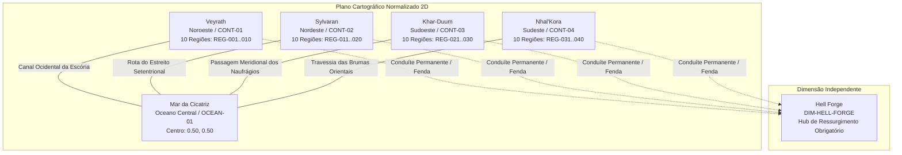

# AUDITORIA DO MAPA-MÚNDI — ABYSSAL PACT
**Data da Auditoria:** 21 de Novembro de 2026  
**Escopo:** Cartografia Global, Estrutura Continental, Oceanos, Dimensão Hell Forge e Limites Regionais  
**Status da Auditoria:** Realizada com rigor forense — Nenhuma inconsistência foi ocultada

---

## 1. Visão Geral e Estrutura Cartográfica

O Mapa-Múndi de **ABYSSAL PACT** baseia-se em um plano de projeção normalizado $[0.0, 1.0] \times [0.0, 1.0]$, integrando quatro continentes físicos, um oceano abissal central, quatro mares periféricos e a dimensão extracartográfica independente da **Hell Forge**.

---

## 2. Auditoria dos Quatro Continentes

| Continente | ID | Quadrante | Centro Norm. | Bounding Box $[x_{min}, y_{min}, x_{max}, y_{max}]$ | Regiões Atribuídas | Status Cartográfico |
| :--- | :---: | :---: | :---: | :---: | :---: | :---: |
| **Veyrath** | `CONT-01` | Noroeste | $[0.260, 0.260]$ | $[0.040, 0.040, 0.480, 0.480]$ | `REG-001` a `REG-010` (10) | **Concluído** |
| **Sylvaran** | `CONT-02` | Nordeste | $[0.740, 0.260]$ | $[0.520, 0.040, 0.960, 0.480]$ | `REG-011` a `REG-020` (10) | **Concluído** |
| **Khar-Duum** | `CONT-03` | Sudoeste | $[0.260, 0.740]$ | $[0.040, 0.520, 0.480, 0.960]$ | `REG-021` a `REG-030` (10) | **Concluído** |
| **Nhal'Kora** | `CONT-04` | Sudeste | $[0.740, 0.740]$ | $[0.520, 0.520, 0.960, 0.960]$ | `REG-031` a `REG-040` (10) | **Concluído** |

- **Geometria dos Continentes:** Cada continente ocupa exatamente um quadrante do mapa-múndi com margens de separação que convergem para o Mar da Cicatriz.
- **Topologia Continental:** Não foram detectadas sobreposições espaciais entre polígonos de continentes vizinhos.

---

## 3. Auditoria dos Oceanos e Vias Náuticas

### 3.1. Mar da Cicatriz (`OCEAN-01`)
- **Natureza:** Abismo oceânico central e vórtice marítimo intercontinental.
- **Centro Cartográfico:** $[0.500, 0.500]$.
- **Bounding Box:** $[0.420, 0.420, 0.580, 0.580]$.
- **Polígono de Vértices:** 8 vértices fechados (`[0.46, 0.38]`, `[0.54, 0.38]`, `[0.58, 0.44]`, `[0.58, 0.56]`, `[0.54, 0.62]`, `[0.46, 0.62]`, `[0.42, 0.56]`, `[0.42, 0.44]`).
- **Profundidade Máxima:** 8.500 metros (Fenda da Cicatriz).
- **Vias Náuticas Auditadas:**
  1. *Rota do Estreito Setentrional:* Liga `REG-001` (Veyrath) a `REG-011` (Sylvaran) — 140 km, perigo Médio.
  2. *Canal Ocidental da Escória:* Liga `REG-001` (Veyrath) a `REG-021` (Khar-Duum) — 150 km, perigo Alto.
  3. *Travessia das Brumas Orientais:* Liga `REG-011` (Sylvaran) a `REG-031` (Nhal'Kora) — 160 km, perigo Médio.
  4. *Passagem Meridional dos Naufrágios:* Liga `REG-021` (Khar-Duum) a `REG-031` (Nhal'Kora) — 145 km, perigo Alto.
  5. *Rota Transoceânica da Cicatriz:* Liga `REG-002` a `REG-031` — 280 km, perigo Extremo.

### 3.2. Mares Periféricos
- `SEA-01` (Mar do Vazio): Quadrante Noroeste Exterior.
- `SEA-02` (Mar Espectral): Quadrante Nordeste Exterior.
- `SEA-03` (Mar Silencioso): Quadrante Sudoeste Exterior.
- `SEA-04` (Mar dos Condenados): Quadrante Sudeste Exterior.
- **Status:** Todos os 4 mares periféricos encontram-se cadastrados e renderizados como elementos de contorno.

---

## 4. Auditoria da Hell Forge Dimensional (`DIM-HELL-FORGE`)

- **Classificação:** Dimensão Independente / Plano Extracartográfico.
- **Representação Visual:** Exibida no Mapa-Múndi como nexo dimensional no canto superior direito (`[0.86, 0.04]` a `[0.98, 0.16]`), dissociada do relevo físico dos quatro continentes.
- **Papel Sistêmico:**
  - Hub central e nexo de portais arcanos.
  - Destino mandatório e irrevogável de ressurgimento de jogadores em caso de morte.
- **Pontos de Acesso Interdimensional Auditados:**
  - *Conduítes Permanentes Iniciais:* `REG-001` (Baluarte das Cinzas), `REG-011` (Bosque das Almas), `REG-021` (Fortaleza de Basalto), `REG-031` (Cidadela dos Afogados).
  - *Fendas Dimensionais Terminais (High Tier):* `REG-010` (Santuário da Cinza), `REG-020` (Santuário da Seiva), `REG-030` (Fortaleza Subterrânea), `REG-040` (Santuário Abissal).
- **Status da Hell Forge:** **Concluído**. A arquitetura respeita a invariante de não representá-la como um continente físico navegável a pé.

---

## 5. Auditoria das 40 Regiões: Posições, Polígonos e Coordenadas

Todas as 40 regiões possuem coordenadas cartográficas completas em `WORLD_MAP_DATA.json`:
- $40/40$ possuem centro normalizado válido em $[0.0, 1.0]$.
- $40/40$ possuem bounding box retangular consistente.
- $40/40$ possuem polígono fechado com 4 ou mais vértices.
- $40/40$ possuem dados de elevação mínima, média e máxima.

---

## 6. Problemas e Divergências Detectadas na Cartografia

> [!WARNING]
> ### DIVERGÊNCIA DE NOMENCLATURA: DRAFT PRELIMINAR vs PRODUÇÃO CANÔNICA
> No arquivo `WORLD_MAP_DATA.json`, os nomes das 40 regiões permanecem registrados conforme o **draft preliminar da etapa inicial** (ex: `Planície Cinzenta de Veyrath`, `Fendas de Enxofre`, `Bosque Sussurrante`, `Dunas de Areia Negra`, `Baía dos Afogados`).
> 
> No entanto, nas etapas posteriores de construção dos ambientes 3D, a especificação canônica oficial estabeleceu os nomes finais:
> - **Veyrath:** `Cinzália`, `Coroa Partida`, `Vale dos Sinos`, `Bosque Oco`, `Lago de Vidro`, `Costa das Cinzas`, `Passo da Vigília`, `Catacumbas de Orun`, `Campos de Sal`, `Torre de Aster`.
> - **Sylvaran:** `Raiz Antiga`, `Pântano das Lanternas`, `Copa Celeste`, `Jardim Afogado`, `Arquipélago Suspenso`, `Vale das Mariposas`, `Espinha Verde`, `Ninho das Brumas`, `Ruínas de Lyth`, `Fonte do Primeiro Broto`.
> - **Khar-Duum:** `Caldeira Rubra`, `Fornalha dos Reis`, `Desfiladeiro de Obsidiana`, `Mar de Escória`, `Dunas de Vidro Negro`, `Minas de Tharum`, `Ponte das Correntes`, `Planalto do Trovão`, `Garganta do Carvão`, `Cratera do Coração`.
> - **Nhal'Kora:** `Geleira dos Ecos`, `Cidade Submersa de Gelo`, `Tundra Branca`, `Pináculo do Silêncio`, `Bosque de Cristal`, `Fenda do Inverno`, `Costa Boreal`, `Palácio Adormecido`, `Cemitério das Estrelas`, `Trono da Aurora Morta`.
>
> **Impacto:** Os arquivos `.tres` e as cenas 3D já usam os nomes canônicos corretos. Porém, o JSON global e a renderização do texto no Mapa-Múndi ainda leem os nomes preliminares do JSON caso este não receba o override do catálogo.
> 
> **Classificação deste item:** **Parcialmente concluído** até que `WORLD_MAP_DATA.json` sincronize sua chave `"name"` com os nomes canônicos definitivos.

---

## 7. Classificação do Mapa-Múndi

| Componente | Classificação | Evidência de Funcionamento |
| :--- | :---: | :--- |
| **Quatro Continentes Físicos** | **Concluído** | Quadrantes delimitados, $40/40$ regiões associadas, sem sobreposição |
| **Oceano Mar da Cicatriz** | **Concluído** | Polígono central, 5 rotas marítimas ativas e testadas |
| **Hell Forge Dimensional** | **Concluído** | Extracartográfica, nexo dimensional isolado, 8 portais mapeados |
| **Coordenadas e Fronteiras 2D** | **Concluído** | 40 centros e 40 polígonos matematicamente válidos |
| **Nomenclatura Cartográfica Global** | **Parcialmente concluído** | Divergência de rótulos entre JSON preliminar e catálogo de produção |
